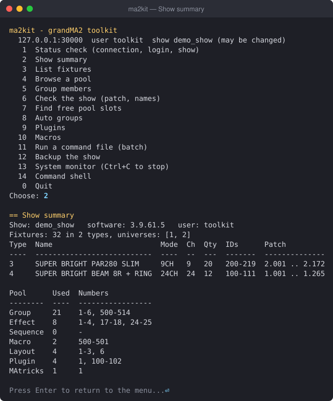

# grandma2-toolkit

Tools for **grandMA2 onPC v3.9.61**: a Python CLI (`ma2kit`) that drives the console over its Telnet
command line, and a manager for Lua plugins that run inside it. Everything reads the loaded show at
runtime, so it works with any fixtures and layout.

> **Safety:** with an MA Command Wing or node connected, commands act on real fixtures. Set
> `[safety] allowed_shows` to a test show while experimenting, and run `ma2kit backup` first.



More screenshots: [docs/08](docs/08-cli-and-safety.md#screenshots).

## Status

| Part | State |
|---|---|
| Connection: Telnet client with dialog handling and auto-reconnect, `doctor`, `cmd`, `shell`, `monitor` | working |
| Interface: interactive terminal menu (Python) with screenshots in [docs/08](docs/08-cli-and-safety.md#screenshots) | working |
| Show reader (`show ...`), auto groups (`groups auto`), `backup` | working |
| Plugin manager (`plugins ...`) and Lua helper library | working |
| Macro manager (`macros ...`), batch files, show checks, free slots | working |
| Reference docs on grandMA2 (concepts, Lua API, commands) and inspection plugins | written, checked on 3.9.61 |
| Color picker, effect helpers, patch helper, pan/tilt wizard | not started |
| Auto groups per layer / thirds / left-right-center / every-Nth, layer column in `show fixtures` | not started |

All "working" parts are tested offline and against onPC 3.9.61. The full checklist of what the project
plan asks for, and what is still missing, is in
[AGENT_BRIEF.md → Status against this brief](AGENT_BRIEF.md#status-against-this-brief-2026-11-12).

## Quick start (Windows, Python 3.11+)

1. In onPC: **Setup → Console → Global Settings → Telnet = Login Enabled**, and create an MA user for
   the tool (**Setup → Console → User & Profiles Setup**). Details: [docs/05-install-and-setup.md](docs/05-install-and-setup.md).
2. Install:
   ```powershell
   python -m venv .venv
   .\.venv\Scripts\python.exe -m pip install -e ".[dev]"
   ```
3. Configure: copy `config.example.toml` to `config.toml` and set the user and password.
   `config.toml` is git-ignored. Alternatively set the `MA2KIT_PASSWORD` environment variable.
4. Check the connection, then open the menu:
   ```powershell
   .\.venv\Scripts\ma2kit.exe doctor
   .\.venv\Scripts\ma2kit.exe
   ```

## Commands

| Command | What it does |
|---|---|
| `ma2kit` / `ma2kit menu` | Interactive numbered menu for everything below. |
| `ma2kit doctor` | Checks config, connection, Telnet, login, version, user rights, loaded show, plugin folder. |
| `ma2kit cmd "List Group"` | Sends one command line and prints the reply. |
| `ma2kit shell` | Interactive command line; asks you when the console opens a dialog. |
| `ma2kit monitor [--filter REGEX]` | Follows the console's system monitor (plugin output, command log). |
| `ma2kit backup` | Saves the show and keeps a timestamped copy in `backups/`. |
| `ma2kit show summary` | Fixtures per type, patch span, and pool usage. |
| `ma2kit show fixtures` | All fixtures as a table, JSON or CSV; `--positions` adds stage X/Y/Z. |
| `ma2kit show pool <Pool>` / `show group <n>` | Any pool's contents; a group's members in order. |
| `ma2kit groups auto [--apply]` | Previews, then creates, ALL/ODD/EVEN/halves/out-in groups per fixture type. |
| `ma2kit show check` | Finds DMX overlaps, patches past 512, unpatched fixtures, duplicate names. |
| `ma2kit show free <Pool> --count N` | First run of N free slots in a pool. |
| `ma2kit plugins list / install / update / run / remove` | Puts this repo's Lua plugins into the show and runs them. |
| `ma2kit macros list / install / update / remove` | Turns plain-text `macros/*.txt` into macros in the show. |
| `ma2kit batch FILE [--apply]` | Previews, then sends, a file of commands; stops at the first error. |
| `--dry-run` (global) | Prints what would be sent, sends nothing. |

## Documentation

grandMA2 reference (each statement marked as checked on 3.9.61 or not):

- [01 How grandMA2 works](docs/01-how-grandma2-works.md): the object tree, fixtures and patch, pools, files on disk
- [02 Lua API](docs/02-lua-api.md): every `gma.*` function on 3.9.61, object classes, properties
- [03 Command cheat sheet](docs/03-command-cheatsheet.md): syntax, reading, storing, import/export, patch editing
- [04 Remote control](docs/04-remote-control.md): Telnet setup, reply formats, dialogs

Using the toolkit:

- [05 Install and setup](docs/05-install-and-setup.md): onPC settings, install, config, troubleshooting
- [06 Show reader and auto groups](docs/06-show-reader-and-groups.md)
- [07 Lua plugins](docs/07-plugins.md): writing plugins, the helper library, how install/update work
- [08 Menu, backup, monitor and safety](docs/08-cli-and-safety.md)
- [09 Macros, batch files and show checks](docs/09-macros-batch-checks.md)
- [CHANGELOG](CHANGELOG.md)

## Development

```powershell
.\.venv\Scripts\python.exe -m pytest
```

Tests run offline against a fake console (`tests/fake_ma2.py`) built from replies captured on onPC 3.9.61.

`tools/screenshots.py` remakes the images in `docs/images/` from the real menu (needs the console).

## Licence

MIT, see [LICENSE](LICENSE). grandMA2 is a product of MA Lighting; this project is not affiliated with it.
